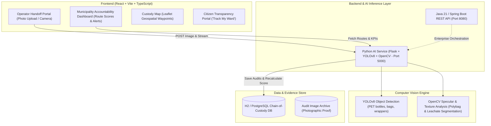

# 🗑️ CustodyWaste AI — Post-Pickup Segregation Integrity Platform
> **Hackathon MVP & Digital Chain-of-Custody System**  
> *"Don't just track whether garbage was collected. Track whether it remained segregated after collection."*

---

## 📌 1. The Core Problem Solved

Every day, conscientious citizens segregate household waste into:
- 🟢 **Wet Waste**: Vegetable peels, kitchen scraps, food waste.
- 🔵 **Dry Waste**: Cardboard, clean plastics, paper, aluminum cans.
- 🔴 **Hazardous Waste**: Batteries, electronics, sanitary waste.

**The Accountability Breakdown:**  
During vehicle loading, secondary transfer hopper dumping, or mechanical compaction, segregated waste is frequently **mixed and contaminated**. Most municipal systems only track vehicle GPS or household collection attendance. 

**CustodyWaste AI** answers the critical question:  
> *If a citizen segregates waste correctly, can the municipal system prove that the waste remained segregated until it reached its processing destination?*

By establishing a **Digital Chain of Custody** across each transportation handoff, municipal authorities can pinpoint exactly which hauler, vehicle, or transfer station caused contamination instead of blaming households or sanitation workers.

---

## 🏗️ 2. System Architecture



---

## 🎯 3. How the Route Integrity Score is Calculated

For any given transportation route with $n$ audited handoffs:

$$\text{Route Integrity Score} = \frac{\sum_{i=1}^{n} w_i \cdot S_i}{\sum_{i=1}^{n} w_i}$$

Where:
- $S_i$ is the AI visual integrity score (0–100) of each audited handoff.
- $w_i$ is the weight of that handoff (equally weighted in the MVP: $w_i = 1$).
- $n$ is the number of handoff stages (Collection $\rightarrow$ Transfer Station $\rightarrow$ Processing Plant Gate).

### 🚦 Municipal Calibration Thresholds:
- **90–100**: 🟢 **High Integrity** (Segregation intact, approved for biological digestion / baling).
- **70–89**: 🟡 **Needs Attention** (Minor foreign trace detected, warning issued).
- **Below 70**: 🔴 **Audit Required / Flagged** (Segregation breach confirmed, operator inspection mandated).

---

## 🎬 4. The 3-Minute Hackathon Pitch Demo Flow

Follow this exact story to demonstrate the core value to the hackathon judges:

1. **Step 1: The Baseline (Citizen Doorstep Collection)**
   - Open the **Municipality Panel**.
   - Show **Route B (Ward 150 - Bellandur South)**.
   - Click **Inspect** to show that at **Stage 1 (Doorstep Collection)**, the audit score was **100/100** (Clean kitchen waste, citizens did their job!).

2. **Step 2: The Handoff Audit**
   - Click **Handoff Audit** tab.
   - Select **Route B**, **Transfer Station**, and **Wet (Organic)** waste.
   - Select the demo scenario: **"Contaminated Wet Waste (Plastic Bottles & Polybags)"** (or upload your own photo).

3. **Step 3: Run AI Computer Vision Assessment**
   - Click **"Run AI Vision Audit"**.
   - Watch the YOLOv8 & OpenCV engine scan the image.
   - The annotated image appears with **Red Bounding Boxes** highlighting foreign PET bottles, plastic wrappers, and blue polybags.
   - Result: **Score: 46–60/100 | Visual Contamination: ~29% | Status: FLAGGED**.

4. **Step 4: Commit to Digital Chain of Custody**
   - Click **"Commit Audit to Digital Chain of Custody"**.
   - Notice the dynamic recalculation: Route B's overall score drops to **66.7/100**.

5. **Step 5: The Municipal Alert & Pinpoint Accountability**
   - Return to the **Municipality Panel**.
   - A pulsing red **CRITICAL NON-COMPLIANCE ALERT** banner appears for Route B!
   - Open the **Route B Digital Chain-of-Custody Inspector**.
   - Show the judges the sequential photographic comparison side-by-side:
     - Collection: 100
     - Transfer Station: 60 (Breakdown pinpointed here!)
     - Plant Gate: 40
   - **The punchline:** *"The citizens did their job. We pinpointed that Hauler KA-04-E-2041 contaminated the batch at Transfer Station TS-04."*

6. **Step 6: Citizen Transparency Portal**
   - Click **Citizen Portal**.
   - Select **Ward 150 - Bellandur**.
   - Show how citizens can verify that their segregation effort is protected and held accountable.

---

## 🚀 5. How to Run

### Quick Launch (Windows)
Double-click `start-demo.bat` in this directory. It will start both services and launch your browser to `http://localhost:5173`.

### Manual Launch

#### 1. Python AI & REST Service (Port 5000)
```bash
cd ai-service
python app.py
```
*Health check:* `http://127.0.0.1:5000/api/health`

#### 2. React + TypeScript Frontend (Port 5173)
```bash
cd frontend
npm run dev
```
*Application URL:* `http://localhost:5173`

#### 3. Spring Boot Java 21 Backend (Optional Enterprise Service - Port 8080)
```bash
cd backend-springboot
mvn spring-boot:run
```

---

### Cloud deployment (Vercel frontend + separate AI API)

The Vite frontend and the Flask AI service are separate deployments. Vercel serves the frontend only; it does not run `ai-service/app.py`. Deploy the Flask service separately, then add this environment variable to the Vercel project:

```env
VITE_API_BASE_URL=https://YOUR-AI-SERVICE-HOST/api
```

The value must point to the Flask service and include the `/api` suffix. Redeploy the frontend after changing the variable because Vite embeds it at build time. For local development, the Vite proxy already forwards `/api` to `http://127.0.0.1:5000`, so this variable can remain unset.

---

## 📡 6. REST API Reference

| Method | Endpoint | Description |
|---|---|---|
| `GET` | `/api/health` | Service status & YOLO model health |
| `GET` | `/api/sample-images` | Preset realistic demo scenarios |
| `POST` | `/api/audit/analyze` | Run YOLOv8 & OpenCV computer vision on waste compartment |
| `GET` | `/api/routes` | Get all routes with real-time Route Integrity Scores |
| `GET` | `/api/routes/{id}` | Get single route with full chain-of-custody audits |
| `POST` | `/api/routes/{id}/audits` | Log handoff audit and update route score |
| `GET` | `/api/analytics` | Fleet-wide KPIs and failure point statistics |
| `POST` | `/api/demo/reset` | Reset demo data to pristine baseline |
| `POST` | `/api/demo/simulate-breakdown` | 1-Click simulation of Route B contamination |

---

## 🏆 7. Hackathon Competitive Advantages

1. **Focuses on the Accountability Gap**: Existing products track if garbage was *collected*. CustodyWaste AI tracks if it *remained segregated*.
2. **Defensible Visual AI**: Employs real YOLOv8 object detection combined with OpenCV color/specular segmentation rather than naive text or static forms.
3. **Citizen Trust Engine**: Restores public confidence in waste segregation programs by proving haulers are audited.
4. **Actionable Municipal Telemetry**: Officials prioritize inspections based on empirical Route Integrity Scores rather than random checks.
